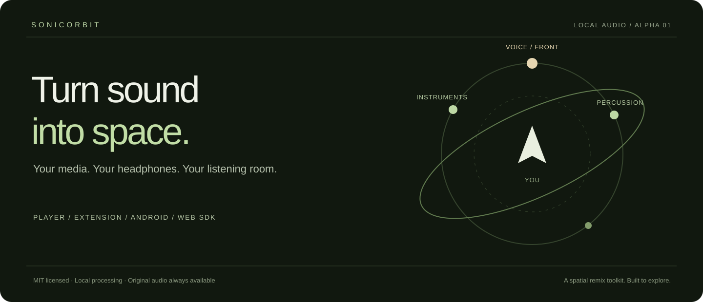
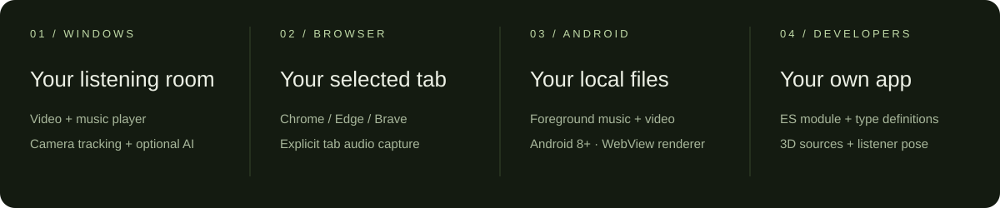
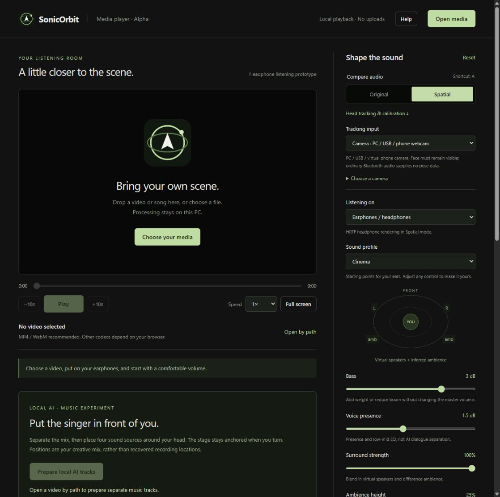
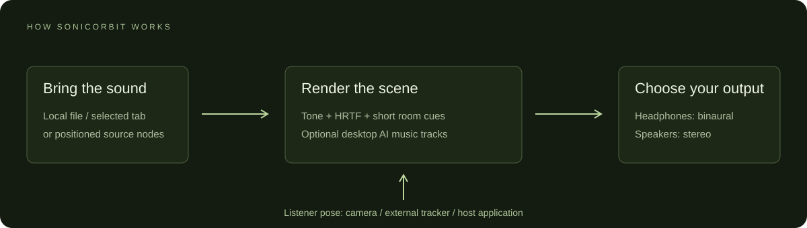

<p align="center"></p>

<p align="center">
<a href="https://github.com/roshan1676/sonic-orbit/releases/tag/v0.2.0-alpha.1"></a>
<a href="LICENSE"></a>
<a href="docs/releases/v0.1.0-alpha.2.md"></a>
</p>

**A local-first spatial-audio toolkit for your headphones.** Play your own media, experiment with a virtual listening room, place broad musical groups around you, and embed the renderer in another browser app.

SonicOrbit includes a desktop media player, a Chromium tab-audio extension, an Android local-file player, and a reusable Web Audio module. This release is an **alpha**: the desktop audio graph and module have automated/browser checks; real extension capture and Android playback still need device testing. It is not an Atmos decoder or a universal system-wide audio driver.

**New: SonicOrbit Native for Windows.** A native player and full offline installer with bundled playback libraries, C++ renderer and MIT-licensed Spleeter AI model. No browser, Python or first-use model download. [Native guide](docs/native-windows.md) · [Native release notes](docs/releases/v0.2.0-alpha.1.md). The browser/extension/Android prototypes remain at alpha 2.

## Download

The new Windows app is in [v0.2.0-alpha.1](https://github.com/roshan1676/sonic-orbit/releases/tag/v0.2.0-alpha.1). Browser/Android downloads remain in the earlier [v0.1.0-alpha.2 release](https://github.com/roshan1676/sonic-orbit/releases/tag/v0.1.0-alpha.2).

| Your route | Download | Start here |
| --- | --- | --- |
| **Windows x64 · Native** | [Offline installer](https://github.com/roshan1676/sonic-orbit/releases/download/v0.2.0-alpha.1/SonicOrbit-0.2.0-alpha.1-windows-x64-setup.exe) · [Portable ZIP](https://github.com/roshan1676/sonic-orbit/releases/download/v0.2.0-alpha.1/SonicOrbit-0.2.0-alpha.1-windows-x64-portable.zip) | Install once; playback, profiles and AI graph are included. [Guide](docs/native-windows.md) |
| **Windows · browser lab** | [Portable player](https://github.com/roshan1676/sonic-orbit/releases/download/v0.1.0-alpha.2/SonicOrbit-0.1.0-alpha.2-windows-x64.zip) | Extract the whole folder, then open **SonicOrbit.exe**. Node is included |
| **Android 8+** | [Development APK](https://github.com/roshan1676/sonic-orbit/releases/download/v0.1.0-alpha.2/SonicOrbit-0.1.0-alpha.2-android.apk) | Install through Android's package installer, then choose a local song/video |
| **Chrome / Edge / Brave** | [Tab extension](https://github.com/roshan1676/sonic-orbit/releases/download/v0.1.0-alpha.2/SonicOrbit-0.1.0-alpha.2-browser-extension.zip) | Extract, use **Load unpacked** in the extensions manager, then enable for a media tab |
| **Developers** | [Web module](https://github.com/roshan1676/sonic-orbit/releases/download/v0.1.0-alpha.2/SonicOrbit-0.1.0-alpha.2-web-sdk.zip) | Import `sdk/spatial-audio.js`. [API guide](docs/web-sdk.md) |
| **Read offline** | [Illustrated documentation](https://github.com/roshan1676/sonic-orbit/releases/download/v0.1.0-alpha.2/SonicOrbit-0.1.0-alpha.2-documentation.zip) | Setup, architecture, limitations and module examples |

[Native guide](docs/native-windows.md) · [Browser/Android guide](docs/getting-started.md) · [Platform compatibility](docs/extension-and-android.md) · [Native checksums](https://github.com/roshan1676/sonic-orbit/releases/download/v0.2.0-alpha.1/SHA256SUMS.txt) · [Browser/Android checksums](https://github.com/roshan1676/sonic-orbit/releases/download/v0.1.0-alpha.2/SHA256SUMS.txt)

The Windows native installer and older launcher are unsigned; the Android APK is development-signed. Verify the source/checksum and use your device's normal installation protections.

## Native app and browser prototypes

The native Windows build has its own C++ core and [experimental C API](docs/native-core.md). It is separate from the browser Web Audio module below. Camera tracking remains in the browser lab; native OpenTrack support currently consumes yaw only. See the [native feature and test details](docs/native-windows.md).



| Capability | Desktop player | Tab extension | Android player | Web module |
| --- | --- | --- | --- | --- |
| Headphone spatialization, tone and short room cues | Yes | Yes | Yes | Yes |
| Original / processed comparison | Yes | Captured stereo | Yes | Host-controlled |
| Four AI music groups with editable placement | Optional setup | — | — | Host supplies sources |
| Camera preview, landmarks and local tracking | Yes; visible face required | — | — | Host supplies pose |
| Full-turn orientation | External OpenTrack bridge | — | — | Host supplies quaternion |
| Alternative measured ear profiles | Stereo and objects | Stereo and direction check | — | Stereo and objects |
| Source height, distance and listener position | Through module API | — | — | Yes |
| Native Unity / Unreal adapters | Planned | — | — | Browser module today |

## Make the scene yours



- **Keep the singer at the screen.** Optional desktop AI separates vocals, drums, bass and other instruments. Give each group its own angle/level. Claps may share percussion; not every instrument is isolated.
- **Turn your head, keep the stage.** Inspect camera landmarks and setup guidance, or connect a compatible external orientation source. A face camera cannot measure a full turn away.
- **Choose your presentation.** Compare Original and Spatial, audition ear profiles for stereo and objects, tune tone and short reflections, or add optional turn-away gain reduction.
- **Build it into your app.** Feed AudioNodes and real source/listener positions into the Web module, with host-owned playback, tracking and output routing.



## A first listen

1. Use a comfortable volume and one headphone spatializer in the output path.
2. Open a familiar MP4/AAC video or MP3/WAV song, then press Play.
3. Compare Original and Spatial during the same moment. Desktop shortcut: **A** when focus is outside a control.
4. Enable camera tracking, face the screen and hold still. First use downloads a small checksum-verified model; frames stay on your PC.
5. AI music tracks are optional: install Python 3.11 and FFmpeg, run **Setup-AI.cmd**, restart, then open media **by path** and prepare tracks. [Full setup](docs/getting-started.md#optional-ai-music-separation).

## Run from source

Requires Node.js 22+; release checks and the portable runtime use Node 24.

```sh
git clone https://github.com/roshan1676/sonic-orbit.git
cd sonic-orbit
npm ci
npm start
```

Open **http://127.0.0.1:3600**. The camera model downloads on first enable, or run `npm run setup:tracking` beforehand. No microphone is requested. Ordinary playback does not need Python, FFmpeg or AI weights.

```sh
npm test                 # DSP, geometry, lifecycle, extension and server checks
npm run build:sdk        # reusable browser module
npm run build:extension  # unpacked Chromium extension
```

Native and complete release builds use the documented Windows build environment. [Build instructions](docs/building-releases.md).

## Know the boundaries

The current renderer outputs **stereo**. Stereo virtual speakers and AI placement do not recover Atmos metadata. Multichannel input is downmixed. HRTF fit varies by listener/headphones. AI separation can introduce artifacts, currently covers the first five minutes, and uses substantial memory/disk. Android processes files opened inside its own foreground app, up to 1 GB; it does not replace every other app's sound. Protected tab content and Bluetooth buffering can limit capture or lip sync.

We have not established better sound, tracking accuracy, performance or latency than Dolby Atmos. Our demonstrated strengths are editable musical placement, visible controls and reusable source. [Read the comparison and evaluation plan](docs/dolby-comparison.md).

## Explore

[Getting started](docs/getting-started.md) · [Module API](docs/web-sdk.md) · [Tracking](docs/tracking-inputs.md) · [Implementation](docs/implementation.md) · [Native architecture](docs/architecture.md) · [Roadmap](docs/milestones.md) · [Contributing](CONTRIBUTING.md) · [Security/privacy](SECURITY.md)

**License:** [MIT](LICENSE) for original SonicOrbit code and illustrations. Dependencies/datasets retain their own terms; see [third-party notices](THIRD_PARTY_NOTICES.md). SonicOrbit is independent and is not affiliated with or endorsed by Dolby.
