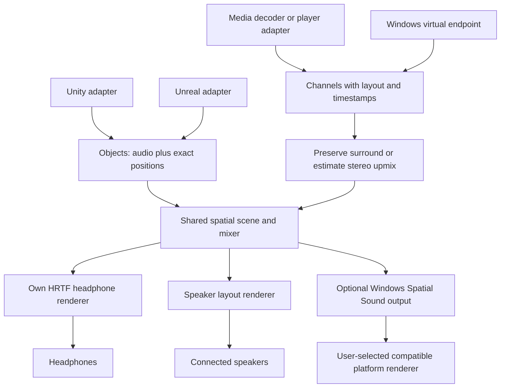

# Architecture proposal

## Scope

Headphones are the primary output. Unity and Unreal must be able to embed the same core used for movies and the Windows companion. External speakers use their actual layout; stereo speakers receive a stereo mix, while supported surround systems receive mapped multichannel audio. Reliable elevation on speakers requires suitable physical speakers or a supported virtualization system.

This is the target native architecture, not an implemented SDK. A browser video prototype now exercises part of the signal flow and optional camera tracking; its implementation and limitations are recorded in README.md. Native choices below are proposed starting points, to be checked against the selected engine versions and target hardware during implementation.

## Shared signal model

Choose one final spatial renderer per output. Do not feed already binaural headphone audio into another surround virtualizer. An optional platform path submits audio and spatial metadata before our own binaural rendering.

Three input types remain explicit:

| Input | Information available | Processing policy |
| --- | --- | --- |
| Game objects | Individual voices, exact transforms, optional geometry/materials | Use supplied positions and acoustic simulation; source separation is unnecessary. |
| Channel audio | Stereo, mono, 5.1, 7.1, or other supported declared layouts | Preserve known channel directions; only estimate missing spatial information. |
| Already binaural audio | Final two-channel headphone mix | Provide direct playback by default; no automatic second spatialization. |

A normal desktop audio tap is not an object-metadata extractor. Native spatial game streams cannot be assumed to appear as individual objects at that tap. Preserve the game's native output through a bypass route when appropriate.

## Core and adapters

Proposed core: C++ with a small versioned C ABI. Keep game-engine classes, file decoders, UI, Windows drivers, and model training outside the core. The ABI should support source handles, mono voice blocks, listener/source transforms, explicit channel layouts, render configuration, and nonblocking status counters.

Use meters, a documented handedness and axis convention, float PCM, and an explicit sample rate and block size. Convert Unity and Unreal coordinates in their adapters. Transform sources relative to the listener exactly once. The game camera/listener orientation and any optional physical head tracking need an explicit composition policy.

| Component | Responsibility |
| --- | --- |
| Unity package | Native plugin binding, editor controls, source/listener components, scene adaptation; C# calls the C ABI. |
| Unreal plugin | Native module, source/listener and geometry adapters, engine audio integration. |
| Media adapter | Decode supported tracks, retain timestamps and channel labels, supply channel blocks and seek/reset events. |
| Windows host | Device routing, virtual endpoint integration, device switching, bypass, and desktop controls. |
| Core | Source lifecycle, transforms, voice prioritization, spatial rendering interface, mixing and output metering. |
| Local inference worker | Optional model execution, confidence estimates, bounded parameter updates and fallbacks. |

Develop Unity and Unreal against the same contract and conformance scenes. Initially implement one adapter end to end, then the second; both are required product targets. Exact supported engine releases are still to be selected.

## Rendering and local algorithms

Evaluate Steam Audio as the initial HRTF/acoustics backend. Its C API supports positional binaural audio, SOFA HRTFs, occlusion, reflections, and propagation. Wrap it behind our interface so upstream functionality is reusable without making every integration depend directly on its types.

Headphone work includes HRTF convolution/interpolation, smooth movement, distance effects, optional environmental sound, profile selection, and optional head tracking. A generic HRTF is a starting point, not a personalized measurement. Listening-based profile selection can be shipped before any learned personalization model.

Speaker output uses explicit speaker positions/channel labels, appropriate panning, and a defined bass-management policy. Headphone HRTF filters must not be reused as the speaker renderer. Any stereo-speaker crosstalk-cancellation experiment is a later feature with a limited listening region, not a universal 360-degree output promise.

Windows Spatial Sound is an optional alternate output backend. Its object API can delegate final rendering to the user's available/enabled system renderer, including Windows Sonic or Dolby Atmos on compatible configurations. Query capabilities and object limits and provide fallback; this does not grant a Dolby license or create our own Dolby encoder.

## AI roles

AI complements known acoustic and spatial information. The following are experiments until models and benchmarks are selected:

1. **Personalization assistance:** choose or rank existing HRTF profiles from listening-test responses. Compare against a simple non-ML selector first.
2. **Media upmix:** estimate dialogue/music/effects and ambience, then apply restrained spatial placement. Separated stems do not reveal the original 3D coordinates. A detected helicopter is not automatically placed overhead.
3. **Acoustics acceleration:** investigate a learned approximation of expensive room effects after a physical baseline exists, using game geometry/materials as inputs.
4. **Quality management:** adjust optional effect cost or source priorities under load while protecting important direct sounds. Start with deterministic rules and justify ML with measured improvements.

Evaluate ONNX Runtime for local inference. It supplies execution infrastructure, not an audio-separation or personalization model. Select model weights, training data, redistribution terms, memory use, and measured inference latency separately. No LLM is required in the sample-processing path.

Full-track separation can be offered as an offline movie preprocessing task. Live media processing must expose its delay, maintain A/V synchronization where the player permits it, and fall back when latency or quality is unacceptable. Do not assume an offline separator is suitable for interactive gaming.

## Real-time contract

- Preallocate processing buffers and source/effect state outside the render callback.
- No model loading, file/network I/O, unbounded waits, heap allocation, or synchronous inference in the render callback.
- Transfer scene updates and worker results through bounded queues or equivalent bounded snapshots. Define ownership and lifetime across threads.
- Interpolate parameter changes. Retain the last usable settings if a worker result is late; use deterministic fallback when a model fails.
- Manage source budgets and preserve effect tails during voice retirement.
- Treat device sample-rate changes, seeks, disconnects, and output switches as explicit lifecycle events.
- Measure total playback delay separately from core processing time. Bluetooth, drivers, device buffers, and inference lookahead contribute additional latency.

## Media compatibility

The reference media path initially targets local files with declared mono/stereo/5.1/7.1 tracks decoded by FFmpeg or a suitable player API. Preserve the original track and video when exporting a converted movie where the container allows it. Verify channel labels, timestamps, subtitles, seeks, and downmix behavior.

Other media players have two routes: direct integration/plugin where the player permits it, or ordinary PCM routing through the Windows endpoint. The latter does not automatically retain encoded Atmos metadata or allow us to delay the player's video for synchronization. Protected or exclusive audio paths may be unavailable. Publish a tested compatibility list rather than promise every player or streaming service.

## Evaluation

Use level-matched, randomized listening tests with front/back, azimuth, elevation, moving sources, and more than one listener and headphone model. Track angular error, front/back confusions, perceived externalization, timbre, and preference separately.

Profile callback execution percentiles, overruns, source counts, memory, and CPU/GPU competition with the game. Capture end-to-end latency rather than inferring it from block size. Include deterministic transforms, channel routing, finite output, tail handling, reset, and lifecycle checks.

Use the same audio and geometry when comparing renderers. Stereo-upmix preference must be assessed separately from object-position accuracy. An improvement in one scene does not establish superiority over Dolby Atmos as a whole.

## Evidence and implementation references

- [Steam Audio C API overview](https://valvesoftware.github.io/steam-audio/doc/capi/index.html): positional rendering, scene acoustics, SOFA support, embeddable C interface.
- [Steam Audio HRTF API](https://valvesoftware.github.io/steam-audio/doc/capi/hrtf.html): custom HRTFs and expensive setup outside the audio thread.
- [Steam Audio repository](https://github.com/ValveSoftware/steam-audio): source and existing Unity/Unreal integrations to evaluate.
- [Microsoft Spatial Sound](https://learn.microsoft.com/en-us/windows/win32/coreaudio/spatial-sound): object/channel output, platform renderers and runtime limitations.
- [ONNX Runtime C++](https://onnxruntime.ai/docs/get-started/with-cpp.html): local CPU and supported GPU inference options.
- [FFmpeg surround filter](https://ffmpeg.org/ffmpeg-filters.html#surround): baseline channel upmix to compare against.
- [MVSEP cinematic demixing](https://github.com/ZFTurbo/MVSEP-CDX23-Cinematic-Sound-Demixing): example dialogue/effects/music separation research implementation.
- [Microsoft SYSVAD](https://learn.microsoft.com/en-us/windows-hardware/drivers/audio/sample-audio-drivers): a virtual-device development reference, not a complete application-routing solution.

Record exact dependency versions and verify code, model-weight, and dataset terms when dependencies are selected for redistribution.
