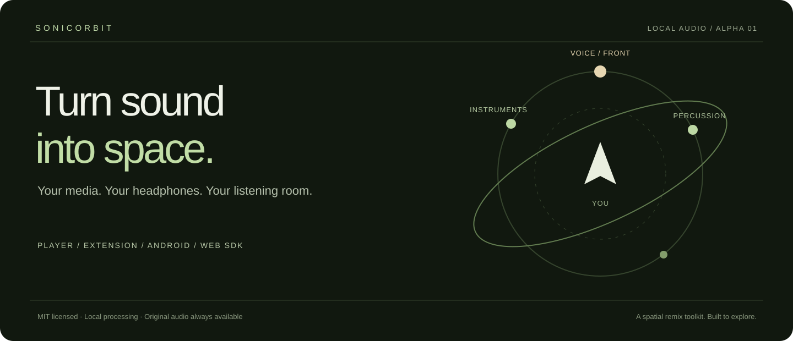
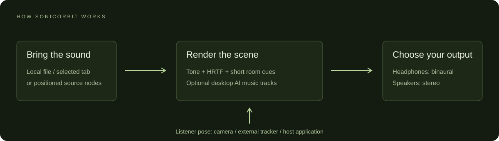

# Your first SonicOrbit session

## Windows: extract, open, listen

Download the Windows x64 portable ZIP from [Releases](https://github.com/roshan1676/sonic-orbit/releases/tag/v0.1.0-alpha.2). Extract **all** of it into a writable folder. Open `SonicOrbit.exe`. The bundled local server starts without a terminal and opens the interface in your browser. No separate Node installation or administrator rights are required.

Keep all packaged folders beside the launcher; running inside the ZIP will not work. The launcher chooses an available local port between 3600 and 3699. Open it again to reopen its session. Closing the browser tab does not stop the server; run `Stop-SonicOrbit.cmd` to stop the instance belonging to that package. Only process/port state is remembered, not media history.

Choose **Open media**, or drop a song/video onto the stage. MP4/H.264/AAC, MP3 and WAV are useful first tests. Other codecs depend on your browser. Press Play and compare Original/Spatial at comfortable volume. **Help** explains optional setup. For launcher diagnostics, open a terminal in the package folder and run `runtime\node.exe server.mjs --open`.

## Anchor the stage

Choose Camera and enable tracking. First use downloads Google's pinned, checksum-verified face model. Grant camera access when prompted; no microphone is requested. Face the screen and hold still, then turn gently. The monitor/overlay show mirrored video, landmarks and framing guidance. **Tune from a still-head sample** suggests filter/rate settings from pose variation and inference cost; it cannot establish absolute accuracy.

If turns are reversed, select **Reverse turn direction** and Recenter. Recenter after changing seats. A face camera needs a visible face; a full turn needs an actual orientation sensor/bridge. Bluetooth audio alone need not expose any sensor. See [tracking inputs](tracking-inputs.md). If an in-app browser stalls on permission, use the same local URL in Edge or Chrome.

## Optional AI music separation

Ordinary playback works without Python or FFmpeg. To enable desktop AI:

1. Install Python **3.11** from [python.org](https://www.python.org/downloads/) with the Windows `py` launcher.
2. Install a suitable [FFmpeg build](https://ffmpeg.org/download.html), add it to PATH, and verify `ffmpeg -version` in a new terminal.
3. Run **Setup-AI.cmd** in the extracted player folder. It creates `.venv-audio` and installs Demucs 4.1.0 plus SciPy; dependencies can be large.
4. Stop/reopen SonicOrbit so it detects the environment.
5. Use **Open by path**, then **Prepare local AI tracks**. First separation downloads weights; your media is not uploaded.

Keep vocals at 0° for a singer at the screen. Negative angles are left, positive right, ±180° behind. Start with the front-stage layout, modest room reflections and low turn-away focus. The model produces vocals, drums, bass and other instruments; claps may share drums and several instruments may share “other.” Leakage/artifacts are expected.

The first five minutes are prepared, using substantial disk/RAM. Prepared tracks play at 1×. The player returns to stereo beyond the prepared portion; long films need a future chunked implementation.

## Browser extension

Extract the extension ZIP and use **Load unpacked** in the extensions manager. Select the folder containing `manifest.json`. On a playing media tab, open SonicOrbit's icon and choose **Enable for this tab**. **Restore tab audio** stops processing.

This processes the selected tab's stereo mix without page-content injection or a microphone. Desktop AI and live tracking are not included; head turn is a manual preview. Protected content, file tabs and browser variants need testing. [Full guide](extension-and-android.md#desktop-chromium-extension).

## Android

Open the development APK through Android's package installer. Launch SonicOrbit, choose a song/video using the file picker, then press Play. The app supports Android 8+ with a recent System WebView. A selected file is copied to private cache for seeking, with a 1 GB limit. It pauses in the background.

The APK has no Internet, microphone, camera or broad storage permissions. It processes files inside its own app, without on-phone AI separation or real head tracking. Build/signature verification is complete; live phone playback and latency still require device testing. [Details](extension-and-android.md#android-apk).

## Troubleshooting

| Symptom | First check |
| --- | --- |
| Ears sound identical | Run the left/right test; check OS mono settings and the actual output device |
| Surround is weak | Try the controlled moving source, audition ear profiles for AI objects, and reduce competing spatializers |
| Voice sounds muddy | Reduce bass/room level and compare Original |
| Audio arrives late | Compare wired and Bluetooth; capture/device buffering adds delay |
| AI setup required | Check the Python environment and FFmpeg, then restart; use Open by path |
| Camera is lost/stuck | Check browser permission, lighting and framing; visible-face tracking cannot follow a full turn away |

[Report an issue](https://github.com/roshan1676/sonic-orbit/issues) with package/version, OS/browser/WebView, output connection and a short reproduction. Avoid private media, face frames and personal paths.
